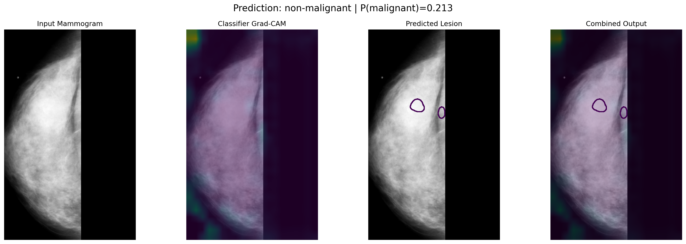
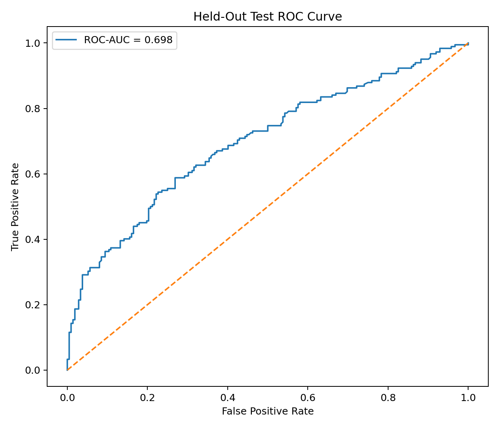
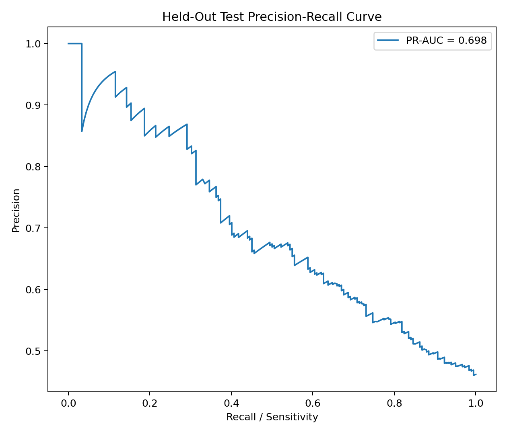
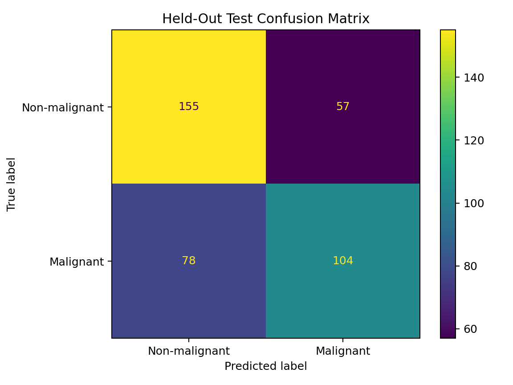
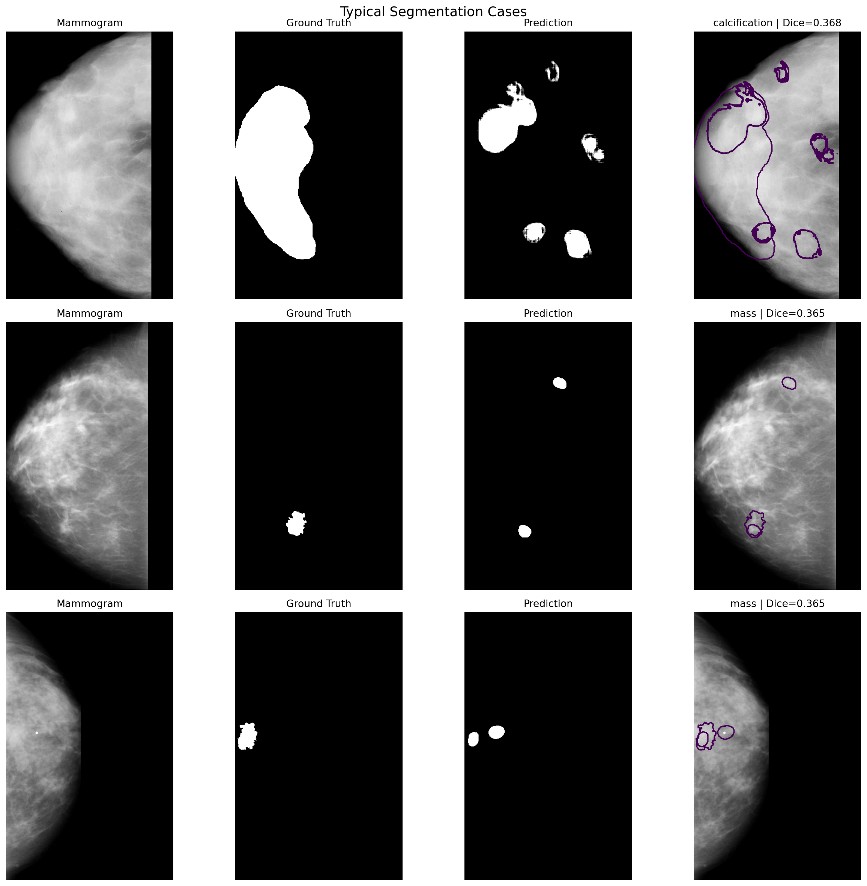
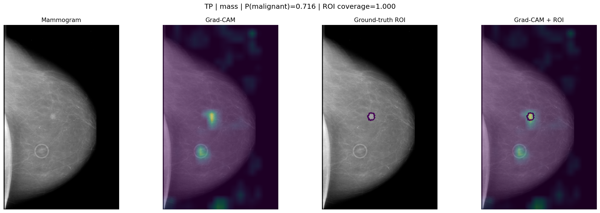
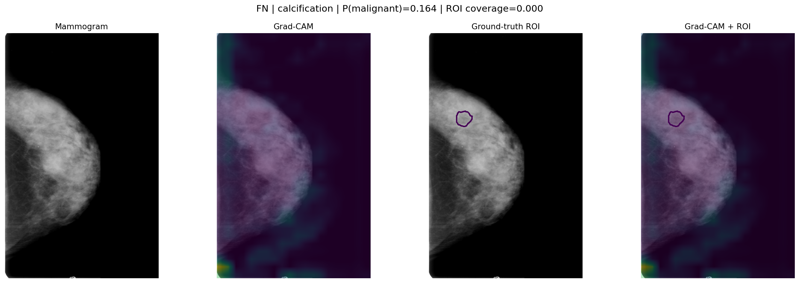

# Breast cancer detection on CBIS-DDSM

An end-to-end research pipeline for mammogram malignancy classification,
qualitative Grad-CAM analysis, and full-image lesion segmentation. The project
uses patient-disjoint train/validation/test splits and reports the held-out test
set only after model and threshold selection were locked on validation data.

> **Research and educational use only.** This repository is not a medical
> device, has not been clinically validated, and must not be used for diagnosis
> or patient care.



## Technical story

1. CBIS-DDSM mammograms and ROI masks are resolved, aligned, breast-cropped,
   merged by mammogram, and split at the patient level.
2. A ResNet-50 malignancy classifier is trained in two stages: its head, then
   `layer4` plus the head. The validation-selected checkpoint becomes the shared
   encoder for segmentation.
3. A vanilla full-image U-Net establishes a segmentation baseline. A
   ResNet50-U-Net then trains its decoder with the encoder frozen and fine-tunes
   `layer4` with a smaller learning rate.
4. Classification and segmentation thresholds are selected on validation data,
   locked, and used once for held-out test evaluation.
5. Grad-CAM is reported as qualitative attention evidence, not as precise
   localization.

## Results

The model-ready dataset contains 2,687 images: 1,885 train, 408 validation, and
394 held-out test images. Patients do not overlap between splits.

### Classification

The exact validation-selected classifier threshold is `0.29150390625`.

| Held-out test metric | Value |
|---|---:|
| ROC-AUC | 0.6979 |
| PR-AUC | 0.6978 |
| Accuracy | 0.6574 |
| Balanced accuracy | 0.6513 |
| Precision | 0.6460 |
| Sensitivity | 0.5714 |
| Specificity | 0.7311 |
| F1 | 0.6064 |
| Confusion matrix (TN / FP / FN / TP) | 155 / 57 / 78 / 104 |

The selected classifier checkpoint reached validation ROC-AUC **0.8227**.
Machine-readable values are in
[`results/classification/evaluation/final_test_metrics.json`](results/classification/evaluation/final_test_metrics.json).

<p align="center">
  
  
  
</p>

### Segmentation

The segmentation threshold was selected on validation data and locked at
`0.9` before the test split was evaluated.

| Stage | Validation soft Dice |
|---|---:|
| Vanilla U-Net baseline | 0.1532 |
| ResNet50-U-Net, decoder only | 0.3329 |
| ResNet50-U-Net, `layer4` fine-tuning | 0.3571 |

| Held-out test metric (394 images) | Value |
|---|---:|
| Mean soft Dice | 0.3493 |
| Mean hard Dice | 0.3695 |
| Median hard Dice | 0.3663 |
| Mean IoU | 0.2699 |
| Median IoU | 0.2242 |
| Mean precision | 0.4329 |
| Mean recall | 0.4414 |

The final validation re-evaluation was soft Dice 0.3567; the separately logged
training-stage best was 0.3571. The small difference reflects distinct
evaluation passes, not a substituted checkpoint. Exact held-out values and
patient-bootstrap intervals are in
[`results/segmentation/final/final_segmentation_evaluation.json`](results/segmentation/final/final_segmentation_evaluation.json).



### Grad-CAM

Correct malignant predictions showed greater annotated-ROI overlap than false
negatives or benign predictions, and mass lesions showed stronger alignment
than calcifications. Attention remained diffuse, so the maps should be treated
as qualitative classifier explanations only.

<p align="center">
  
  
</p>

## Repository layout

```text
notebooks/                    Executed experiment records, ordered 02-10
scripts/                      Dataset preparation and reconstructed cache stage
src/breast_cancer_detection/  Reusable model and inference code
results/                      Compact JSON/CSV evidence used in this README
figures/                      Selected experiment visualizations
examples/                     Command-line inference example
docs/                         Methodology and reproducibility details
data/                         Dataset acquisition and expected layout
models/                       Checkpoint manifest (weights are intentionally omitted)
tests/                        Lightweight contract tests
```

See [`notebooks/README.md`](notebooks/README.md) for the stage mapping and
[`docs/methodology.md`](docs/methodology.md) for the complete selection order.

## Setup

Python 3.10 or newer is recommended.

```bash
python -m venv .venv
source .venv/bin/activate
python -m pip install --upgrade pip
python -m pip install -e '.[notebooks,test]'
```

The data and checkpoints are not stored in Git. Download the
[CBIS-DDSM collection](https://www.cancerimagingarchive.net/collection/cbis-ddsm/),
follow [`data/README.md`](data/README.md), and place the two inference weights
described in [`models/README.md`](models/README.md).

## Inference

Inference accepts the prepared `uint16`, `1024 x 640` NPY format produced by the
cache builder. It deliberately does not pretend to accept arbitrary DICOM files.

```bash
python examples/run_inference.py path/to/image.npy \
  --classifier-checkpoint models/resnet50_layer4_best.pth \
  --segmentation-checkpoint models/resnet50_unet_layer4_best.pth \
  --output inference.png
```

The command applies the locked classifier threshold `0.29150390625` and locked
segmentation threshold `0.9`.

## Reproducibility boundaries

- Executed notebooks and compact results are preserved, but large datasets and
  model checkpoints are omitted from Git.
- `scripts/build_model_ready_cache.py` is a documented reconstruction of the
  deterministic final cache transformation; that exact historical filename was
  not preserved during the original run.
- Notebook paths refer to the original Kaggle environment and must be adapted
  when rerunning locally.
- Package requirements name dependencies but do not claim the exact historical
  environment; the original environment lockfile was not available.
- The end-to-end notebook records a rounded display of the classifier threshold.
  Its historical output is unchanged; reusable code and documentation use the
  exact locked value `0.29150390625`.

The repository currently has no explicit code license. CBIS-DDSM access and use
remain subject to the collection's terms and citation requirements. The dataset
paper is available from
[Scientific Data](https://www.nature.com/articles/sdata2017177).
